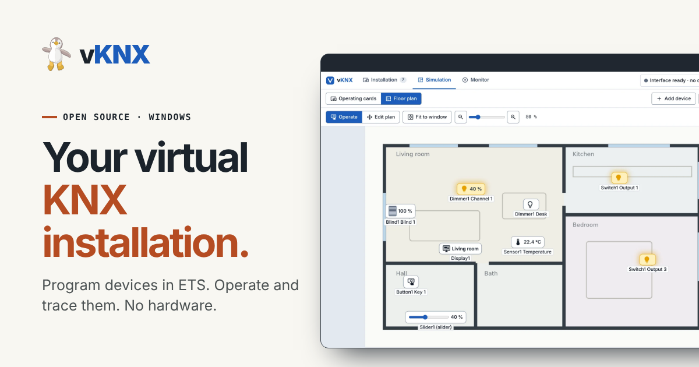
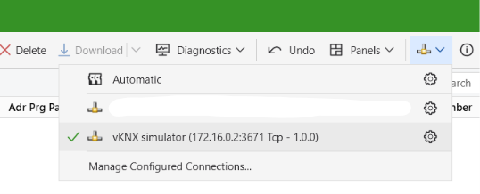
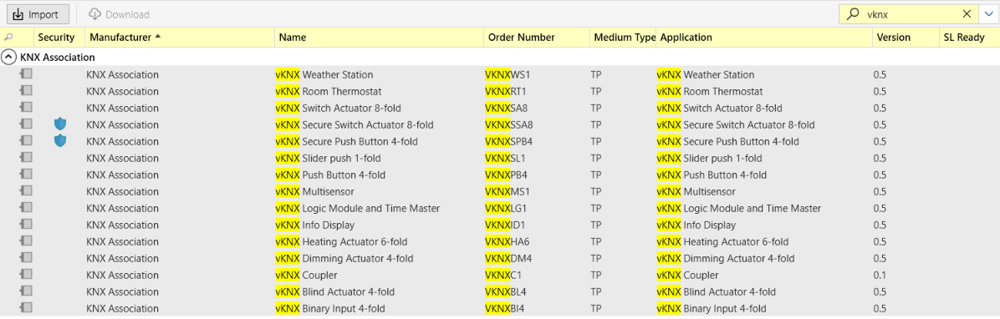
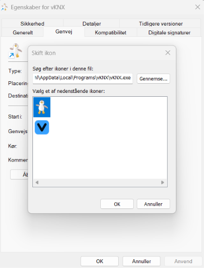

# vKNX - Your virtual KNX installation



<p align="left">
  
</p>

Open-source teaching simulator for KNX, developed by [Marc Sonne Dahl](https://www.marcdahl.dk). Goal: students program **virtual devices from real ETS** (import the products, assign an individual address, set parameters and group addresses, press the programming button, download) without any physical KNX hardware – and then operate buttons, lamps, dimmers, blinds and sensors in a single control panel. Windows is the target platform; only our own generic teaching products are included.

> ## Status: prototype
> Confirmed in ETS 6.4 by the project owner: connection, import, addressing and download for the push button, switch actuator, dimmer, slider push button and the multisensor (version 1). **The newest products (binary input, room thermostat, heating actuator, weather station), the weather alarms of the blind actuator, the changed multisensor and the other products listed below as "not tried" have not been tried in ETS yet.** See `docs/limitations.md`. Nothing may be described as "tested with ETS" before that test has been run.

## What is included
- Java 21 + [Calimero](https://github.com/calimero-project) (KNXnet/IP server, virtual devices) – see `docs/decisions.md`

- 15 products (two of them KNX Data Secure variants, see `docs/limitations.md`): push button (4 keys: switch, relative dimming or blinds), slider push button, switch actuator (8 outputs), dimming actuator (4 channels), blind actuator (4 channels; with wind and rain alarm inputs for awnings), binary input (4 inputs for contacts), room thermostat (simulated room, four operating modes, window contact, two-point or PI control value), heating actuator (6 valves, on/off or PWM, normally closed or open, monitoring with emergency position), weather station (outdoor temperature, wind speed, brightness, rain sensor and a wind alarm; **the four new products are not tried in ETS yet**), secure push button and secure switch actuator (KNX Data Secure: serial number and FDSK shown in the device details for ETS; **not tested in ETS yet**), multisensor (6 measurements, each with its own group object and ETS page), info display (up to 5 named screens with 6 rows each that show on/off status, percent values, the active scene and the multisensor values; paged on the card or with two group objects), a logic module and time master (16 inputs and 16 outputs as 1 bit group objects, a gate editor in the control panel, date and time telegrams and eight weekday timers; **not tried in ETS yet**), one coupler for line and area couplers (real line routing with hop count and filter table from the ETS download, not tested in ETS yet). Keys, outputs and channels can be disabled and named in ETS.
- ETS product XML generated from the same product definition the backend runs on
- Control panel (light/dark) with three workspaces: *Installation* (catalogue, device details, programming button, parameters, objects), *Simulation* (operating cards or floor plan, compact telegram monitor underneath) and *Monitor* (telegram table with filters, group address overview with configured-vs-observed)
- **Share an installation:** *Settings → Share* exports the whole installation (devices with addresses and downloads, floor plan, icons) as one `.vknx` file and imports such a file from someone else, so a finished teaching installation can be handed out and opened on any PC
- Windows application with installer, its own window (WebView2) and "Check for updates" – see `CHANGELOG.md`
- Not yet: an environment panel (sun, outdoor weather shown on the plan), cooling in the thermostat, an ETS plug-in for the logic editor (see `docs/limitations.md`)



## Build and run
Requires JDK 21 and git (no Maven/Gradle).

Linux/macOS (used for development):
```
tools/build.sh          # fetches the pinned Calimero sources, compiles everything
tools/selftest.sh       # backend self-test (NOT an ETS test); also: TunnelTest, CrcCrossCheck
tools/run.sh            # starts simulator + control panel on http://127.0.0.1:8080/
```
**Windows application:** download `vKNX-Setup-<version>.exe` from [Releases](https://github.com/MrDahl/vKNX/releases/latest) and run it (no administrator rights needed; Windows may warn about an "unknown publisher" because the program is not code-signed – choose "Run anyway"). Start vKNX from the start menu and allow it through Windows Firewall on private networks so ETS can find the interface. Java is included; the installer also installs the Microsoft WebView2 Runtime (for the window) if the PC does not have it (internet needed for that step; without it vKNX opens in your browser). To update: cog icon → "Check for updates". Alternatively download `vKNX-<version>-windows.zip` (unzip and run without installing). Data (devices, floor plan, log) lives in `%LOCALAPPDATA%\vKNX\data`.

**Releases (for the maintainer):** write the changes in `CHANGELOG.md` under `## [x.y.z]`, then run the GitHub Actions workflow "windows-exe" with *Run workflow* and the version number (or push a tag `vx.y.z`). It builds, smoke-tests, creates the installer and zip, and publishes the release with the CHANGELOG text as release notes.

Windows (PowerShell; the build is exercised in GitHub Actions on Windows): `tools\build.ps1`, `tools\selftest.ps1`, `tools\start.ps1`, `tools\gen-products.ps1`, `tools\make-knxprod.ps1`.

Options: `--port 3671 --web 8080 --name "vKNX" --dir runtime --line 1.1 --no-browser --device product:name`. Log file: `runtime/vknx.log`.

## Getting the products into ETS
1. Generate the product XML (already included in `products/`; regenerate with `tools/gen-products.ps1` after changing `Products.java`).
  a. Alternatively download finished and compiled products from `knxprod/` and import to ETS (Catalogs → Import).
2. Convert all XML files to `.knxprod` with `tools/make-knxprod.ps1` (needs OpenKNXproducer in `%USERPROFILE%\bin` and ETS installed).
3. Import the `.knxprod` files in ETS (Catalogs → Import), add the devices to a project, add a KNXnet/IP interface pointing at the vKNX address shown in the panel, and program the devices.

**Tip – several lines, one interface:** you do not have to change the interface address in ETS for every line you download to. Give the vKNX interface the address of the main line, for example **1.0** when you have the lines 1.1, 1.2 and 1.3, and then download to devices on all three lines without switching. Line couplers route the telegrams, and the filter tables are updated from the coupler download.

> **Note on the manufacturer name in ETS:** ETS shows these products with the manufacturer **"KNX Association"**. That is only because vKNX uses manufacturer ID `0x00FA`, the ID KNX Association reserves for tests and experiments; ETS looks the name up from the ID. **The products and `.knxprod` files are not made by KNX Association** – they are made by the vKNX project and are not certified or endorsed by KNX Association. A different manufacturer name would need an officially assigned KNX manufacturer ID.

## Icon
vKNX uses a penguin (Pingi) as its program icon. The original blue "V" icon is built into `vKNX.exe` too: right-click the vKNX shortcut → *Properties* → *Change Icon…* and pick the one you like (the `.ico` files are also in the `icons` folder).


## What we use for what
| Part | Used for | License / status |
|---|---|---|
| **Java 21 (JDK)** | Programming language and runtime. Everything is built with plain `javac` – no Maven/Gradle (Maven Central is not needed) | GPLv2+CPE (OpenJDK) |
| **[Calimero](https://github.com/calimero-project)** (`calimero-core`, `calimero-device`, `calimero-server`) | The KNX protocol in Java: telegrams, datapoint types, virtual devices with memory and tables (`calimero-device`), and the KNXnet/IP server that ETS sees as an IP interface (`calimero-server`). Fetched at build time at the pinned commits in `third_party/PINS.txt`, not copied into the repo. A few small local patches (`third_party/patches/`: devices on any area/line, secure telegram drop, fixed interface APDU length, saving a running device) apply on top | GPLv2 + Classpath exception |
| **vKNX code** (`core/`) | Product descriptions, device behaviour (buttons, binary input, actuators, dimmer, blinds, heating, thermostat, sensors), ETS download handling, persistence, web panel and telegram monitor | Apache-2.0 |
| **Web panel** (built-in HTTP server + plain HTML/JS) | Operating buttons, showing lamps/dimmers/blinds/sensors and the telegram monitor | part of vKNX |
| **Product XML generator** (`ProductXmlGenerator`) | Writes the ETS product files (`products/*.xml`) from the same product definitions the simulator uses, so ETS parameters and simulator cannot drift apart | part of vKNX |
| **[OpenKNXproducer](https://github.com/OpenKNX/OpenKNXproducer)** | Converts product XML to `.knxprod`, which ETS can import. Called through `tools/make-knxprod.ps1`. Needs ETS installed on the PC because it uses ETS's own signing DLLs | GPL-3.0 (used as an external tool, not bundled) |
| **ETS 6 (KNX Association)** | Programs the virtual devices (group addresses, parameters, download) – exactly as in a real installation | commercial, not included |
| **jpackage + GitHub Actions** | Builds the Windows application (Java runtime included), so nothing has to be installed to run the simulator | part of the build process |
| **WebView2 launcher** (`launcher/`) | Small Windows program that shows the control panel in its own window and starts/stops the simulator in the background | Apache-2.0; uses Microsoft WebView2 |
| **Inno Setup** | Builds the Windows installer | Inno Setup license (free) |
| **[Material Design Icons](https://pictogrammers.com/library/mdi/)** | Icons in the control panel | Apache-2.0 |
| **PowerShell scripts** (`tools/*.ps1`) | Start, build, self-test and conversion on Windows | part of vKNX |
| **[KNX Explorer](https://github.com/MrDahl/KNX)** | The owner's own teaching app. vKNX is a *separate* project and only refers to it as background and possible reuse (see `docs/knx-explorer-reuse.md`) | owner's own code |
| **Claude (Anthropic, via Claude Code)** | AI assistant that researched, wrote and tested the code and documentation together with the owner. Commits are marked with `Co-Authored-By: Claude`. Claude cannot run ETS; ETS compatibility is only what the owner has confirmed | – |

**Read as reference only (not used in the code):** [thelsing/knx](https://github.com/thelsing/knx) (GPL-3.0), [Kaenx-Creator](https://github.com/OpenKNX/Kaenx-Creator) (MIT) and the OpenKNX templates – used to understand the ETS product format. The Zennio DIMinBOX DX1 is a functional reference only; no Zennio code is included.

**Evidence level:** ETS import, addressing and download are confirmed by the owner in ETS 6.4 for the push button, switch actuator, dimmer, slider push button and (version 1 of) the multisensor. The other products are tested without ETS. See `docs/limitations.md`.

## Documentation
| File | Contents |
|---|---|
| `docs/research.md` | Source-based research (Calimero, thelsing/knx, product tools, other projects) with commits and evidence levels |
| `docs/decisions.md` | Choice of stack and reasons |
| `docs/ets-download-sequence.md` | The ETS download sequence and vKNX's answers |
| `docs/ets-test-guide.md` | **Exact ETS test guide** + which logs we need back |
| `docs/knx-explorer-reuse.md` | Reuse of KNX Explorer and licence suggestion |
| `docs/limitations.md` | Known limitations |

## License
vKNX's own code is under the **Apache License 2.0** (`LICENSE`) – free to use, change and share, also commercially. If you distribute vKNX or a work based on it, you must keep the notice in `NOTICE`: **vKNX was developed by Marc Sonne Dahl (<https://www.marcdahl.dk>)**. Third-party components (Calimero, Java, OpenKNXproducer) have their own licenses, see `THIRD-PARTY-NOTICES.md`. KNX and ETS are registered trademarks of KNX Association; vKNX is independent and not certified.

---

<p align="center">
  
</p>
