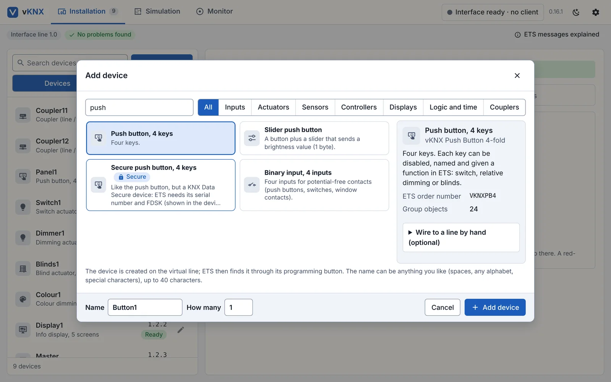
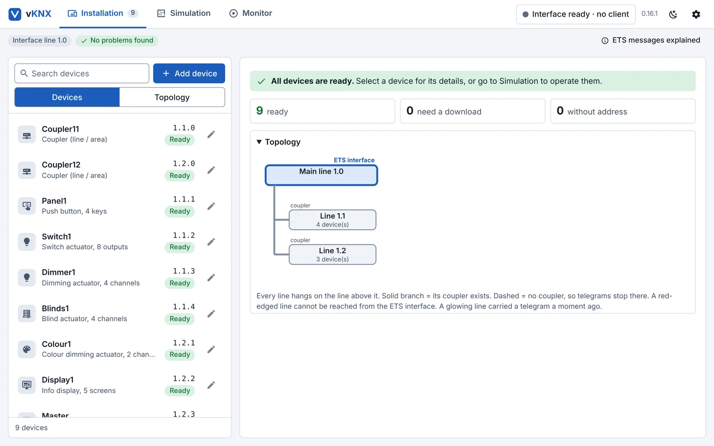
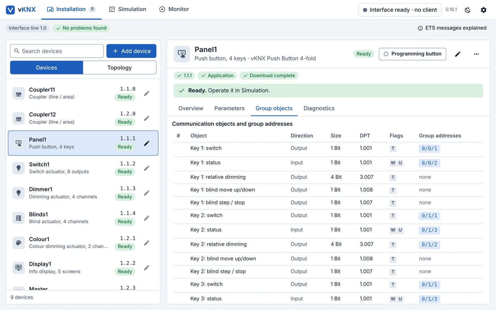
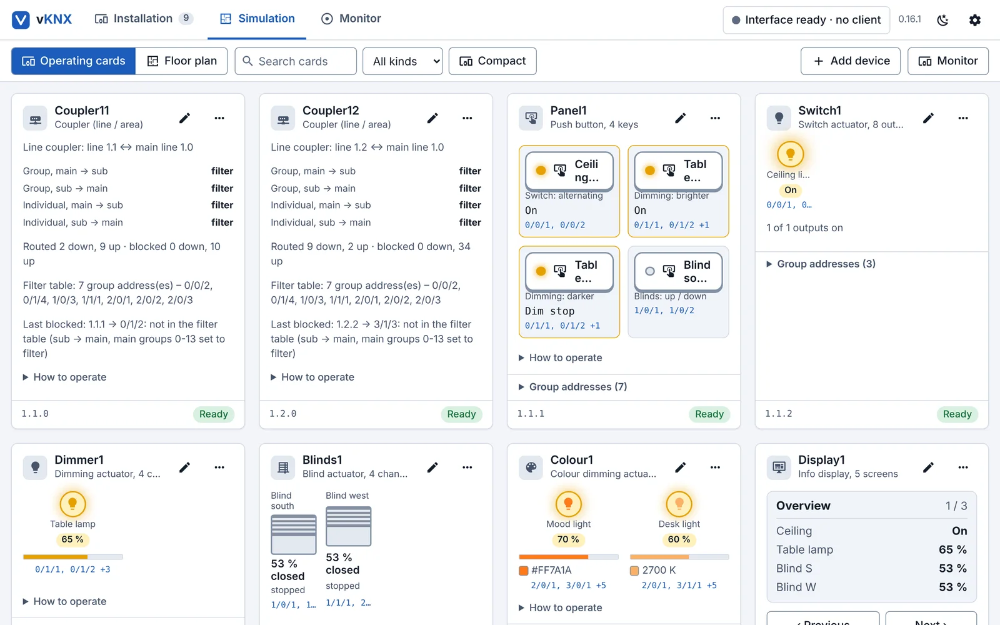
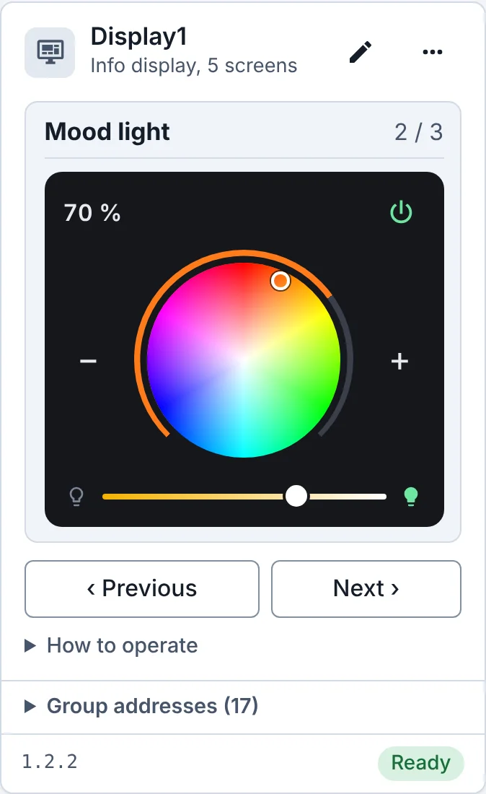
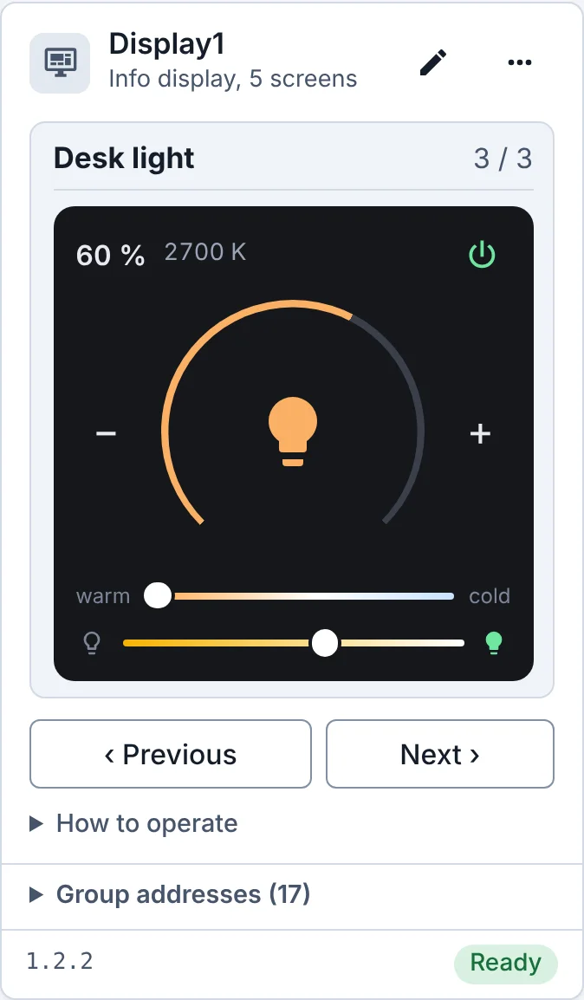
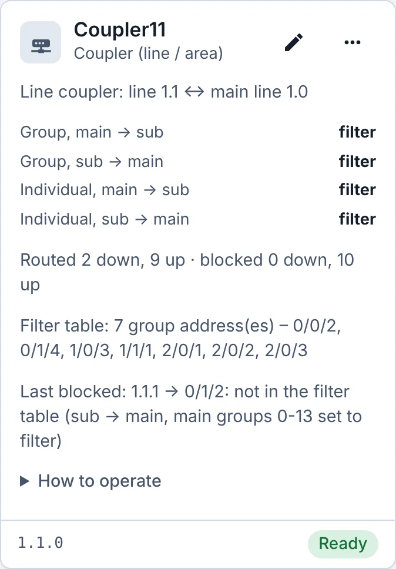
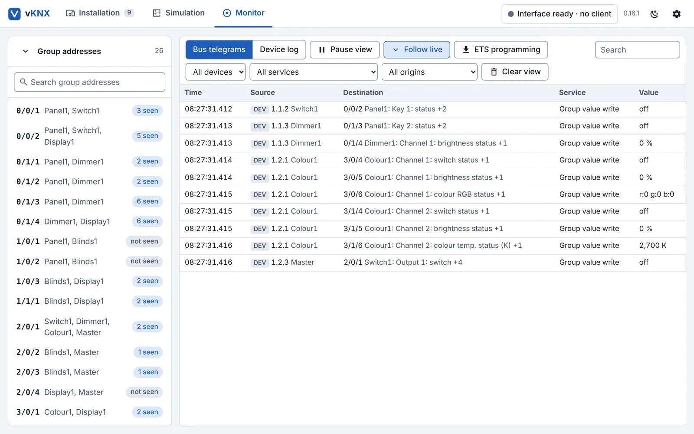

# vKNX with ETS: step-by-step guide

A complete walk-through from "nothing installed" to a working two-line KNX installation: download vKNX, get the `.knxprod` product files, import them into ETS, build the project (topology, individual addresses, parameters, group addresses), download to the virtual devices and test everything.

> **Status of this guide.** The vKNX side (all screenshots, the group address table, the parameters, the object numbers and the coupler filter tables) was checked by building exactly this installation with a test program that behaves like ETS (addresses, application downloads and coupler filter tables) and then operating it: the keys, the display and the central panel work across both lines. The ETS screens themselves are described from what has been confirmed in ETS 6.4.1 (import, addressing, downloads, couplers over several lines, colour dimmer and info display light control); the exact click path can differ a little between ETS versions. If a screen looks different, the idea is the same. Please report anything that does not match.

**Contents**

1. [What you will build](#1-what-you-will-build)
2. [What you need](#2-what-you-need)
3. [Download and install vKNX](#3-download-and-install-vknx)
4. [Get the `.knxprod` files](#4-get-the-knxprod-files)
5. [Import the products into ETS](#5-import-the-products-into-ets)
6. [Plan the installation](#6-plan-the-installation)
7. [Prepare vKNX: interface line and virtual devices](#7-prepare-vknx-interface-line-and-virtual-devices)
8. [Build the project in ETS: topology and devices](#8-build-the-project-in-ets-topology-and-devices)
9. [Set the parameters in ETS](#9-set-the-parameters-in-ets)
10. [Create the group addresses and link the group objects](#10-create-the-group-addresses-and-link-the-group-objects)
11. [Connect ETS to vKNX](#11-connect-ets-to-vknx)
12. [Program the individual addresses](#12-program-the-individual-addresses)
13. [Download the applications](#13-download-the-applications)
14. [Test the installation](#14-test-the-installation)
15. [Changing things later](#15-changing-things-later)
16. [Troubleshooting](#16-troubleshooting)
17. [Ideas for exercises](#17-ideas-for-exercises)
18. [Appendix: group object numbers](#18-appendix-group-object-numbers)

---

## 1. What you will build

An installation with **one area and two lines**, joined by two line couplers on the main line:

```
                          Area 1
        Main line 1.0  (the KNXnet/IP interface "vKNX" sits here: ETS tunnels 1.0.241 ...)
        ================================================================
              |                                          |
        Line coupler 1.1.0                         Line coupler 1.2.0
              |                                          |
        Line 1.1  "Lights and blinds"              Line 1.2  "Colour, display and central panel"
        ------------------------------             ------------------------------------------
        1.1.1  Panel1   Push Button 4-fold         1.2.1  Colour1   Colour Dimming Actuator 2-fold
        1.1.2  Switch1  Switch Actuator 8-fold     1.2.2  Display1  Info Display
        1.1.3  Dimmer1  Dimming Actuator 4-fold    1.2.3  Master    Push Button 4-fold (central panel)
        1.1.4  Blinds1  Blind Actuator 4-fold
```

What it does:

| Where | Function |
|---|---|
| **Panel1** (line 1.1) | Key 1 switches the ceiling light. Key 2 and key 3 dim the table lamp up and down (short press = on/off, long press = dim). Key 4 moves the south blind up and down. |
| **Switch1 / Dimmer1 / Blinds1** (line 1.1) | The ceiling light (switch actuator), the table lamp (dimming actuator) and two blinds (blind actuator). |
| **Colour1** (line 1.2) | Channel 1: an RGB "mood light". Channel 2: a tunable white "desk light". |
| **Display1** (line 1.2) | Screen 1 shows the status of lights and blinds. Screen 2 is a light control for the mood light (on/off, brightness, colour wheel). Screen 3 is a light control for the desk light (on/off, brightness, warm to cold). |
| **Master** (line 1.2) | The central panel. Key 1 is **All off** (switches every light on both lines off). Key 2 **drives all blinds down**. Key 3 drives all blinds up. Key 4 shows the next screen on the display. |

Because the devices sit on two lines, many telegrams must **cross the line couplers** (for example the "All off" key on line 1.2 switches lamps on line 1.1). ETS calculates the coupler filter tables from your group addresses. That is the part of real KNX that this exercise is built to show.

> **Where is "All off"?** In this guide the central panel is on the second line. If you would rather have the All-off key on the first line, use the keys of Panel1 instead, or add a second push button there. Everything else stays the same.

---

## 2. What you need

- A Windows PC (Windows 10 or 11) with **ETS 6** (tested with 6.4.1). ETS and vKNX can run on the same PC, or on two PCs in the same network.
- Internet access for the downloads.
- About one hour for the first run.

The minimum and recommended system requirements are in the [README](../README.md#system-requirements).

---

## 3. Download and install vKNX

1. Open the releases page: <https://github.com/MrDahl/vKNX/releases/latest>
2. Under **Assets**, download **`vKNX-Setup-<version>.exe`** (for example `vKNX-Setup-0.16.1.exe`).
   - Prefer not to install? Download `vKNX-<version>-windows.zip` instead, unzip it and run `vKNX.exe` from the folder.
3. Run the installer. No administrator rights are needed.
   - Windows may show *"Windows protected your PC"* or an *"unknown publisher"* warning, because vKNX is not code-signed. Choose **More info → Run anyway**.
   - If the PC has no *Microsoft WebView2 Runtime* the installer installs it (internet needed). Without it vKNX opens in your web browser instead; the browser must then be a current Edge, Chrome or Firefox.
4. Start **vKNX** from the start menu.
5. When Windows Firewall asks, **allow vKNX on private networks**. This is what lets ETS find the interface. (If you missed the question: Windows Security → Firewall → *Allow an app through firewall* → vKNX.)

You now see the vKNX window with three views: **Installation** (devices, addresses, downloads), **Simulation** (the devices you can operate) and **Monitor** (the telegrams on the bus). The cog icon in the top right opens the settings.

Data (devices, floor plan, logs) is saved in `%LOCALAPPDATA%\vKNX\data`. Update later with cog → **Check for updates**.

---

## 4. Get the `.knxprod` files

A `.knxprod` file is a product database that ETS can import: it tells ETS which parameters and group objects a device has. vKNX has its own products.

**The installer does not contain the finished `.knxprod` files.** They are built by the maintainer (they need ETS to be signed) and are stored in the project's repository:

- Folder: <https://github.com/MrDahl/vKNX/tree/main/knxprod>
- Everything in one file: **`knxprod.zip`** in that folder. Click the file, then the *Download raw file* button (the arrow in the top right of the file view), and unzip it into a folder you will find again, for example `C:\vKNX\knxprod`.

For this guide you need these **seven** files:

| File | Product in ETS |
|---|---|
| `vknx-coupler.knxprod` | vKNX Coupler (one product for line and area couplers) |
| `vknx-push-button.knxprod` | vKNX Push Button 4-fold |
| `vknx-switch-actuator.knxprod` | vKNX Switch Actuator 8-fold |
| `vknx-dimmer.knxprod` | vKNX Dimming Actuator 4-fold |
| `vknx-blind-actuator.knxprod` | vKNX Blind Actuator 4-fold |
| `vknx-colour-dimmer.knxprod` | vKNX Colour Dimming Actuator 2-fold |
| `vknx-info-display.knxprod` | vKNX Info Display |

The folder also contains the other products (slider push button, multisensor, logic module, thermostat and more). You can import them all at once; they just do not appear in this exercise.

**Use the files from the same vKNX version.** The product files and the program belong together. If you update vKNX, download the `.knxprod` files again (the release notes in `CHANGELOG.md` say when a product changed).

---

## 5. Import the products into ETS

1. Start ETS and open the **Catalogs** tab.
2. Click **Import** (top left of the catalog view) and select the `.knxprod` files you unzipped. You can select several at once (Ctrl+A in the file dialog selects all).
3. ETS imports them one by one. Watch for warnings and write down any text ETS shows.
4. In the catalog, the manufacturer is listed as **"KNX Association"** (manufacturer ID `0x00FA`). That is how experimental products are labelled in KNX; the vKNX products are **not** made or certified by the KNX Association. Open it and you will see the products named *vKNX …*.

**Updating products.** If an older vKNX version is already in the catalog, ETS may offer an update, or complain about the product. If it complains, remove the old vKNX entries from the catalog first and import again. In an existing project, devices from an older product version can be updated with *Update device* in ETS.

---

## 6. Plan the installation

Always plan the addresses before you click. A table like this is what an electrician or KNX programmer would hand over.

### 6.1 Individual (physical) addresses

| Address | Device | Name in ETS and vKNX | What it does |
|---|---|---|---|
| 1.1.0 | vKNX Coupler | Coupler11 | Line coupler, joins line 1.1 to main line 1.0 |
| 1.2.0 | vKNX Coupler | Coupler12 | Line coupler, joins line 1.2 to main line 1.0 |
| 1.1.1 | Push Button 4-fold | Panel1 | Ceiling light, table lamp (dim), south blind |
| 1.1.2 | Switch Actuator 8-fold | Switch1 | Ceiling light |
| 1.1.3 | Dimming Actuator 4-fold | Dimmer1 | Table lamp |
| 1.1.4 | Blind Actuator 4-fold | Blinds1 | Blind south, blind west |
| 1.2.1 | Colour Dimming Actuator 2-fold | Colour1 | Mood light (RGB), desk light (tunable white) |
| 1.2.2 | Info Display | Display1 | Status screen and two light control screens |
| 1.2.3 | Push Button 4-fold | Master | All off, blinds down, blinds up, next screen |

Use the **same names** in ETS and in vKNX. They are not exchanged between the programs, but identical names stop you from mixing up devices later.

### 6.2 Group addresses (3-level: main / middle / sub)

| Group address | Name | Datapoint type |
|---|---|---|
| **0 Lights** | | |
| 0/0/1 | Ceiling light switch | 1.001 Switch |
| 0/0/2 | Ceiling light status | 1.001 Switch |
| 0/1/1 | Table lamp switch | 1.001 Switch |
| 0/1/2 | Table lamp relative dimming | 3.007 Dimming control |
| 0/1/3 | Table lamp switch status | 1.001 Switch |
| 0/1/4 | Table lamp brightness status | 5.001 Percentage |
| **1 Blinds** | | |
| 1/0/1 | Blind south move up/down | 1.008 Up/Down |
| 1/0/2 | Blind south step/stop | 1.007 Step |
| 1/0/3 | Blind south position status | 5.001 Percentage |
| 1/1/1 | Blind west position status | 5.001 Percentage |
| **2 Central** | | |
| 2/0/1 | All off | 1.001 Switch |
| 2/0/2 | All blinds move up/down | 1.008 Up/Down |
| 2/0/3 | All blinds step/stop | 1.007 Step |
| 2/0/4 | Display next screen | 1.001 Switch |
| **3 Colour lights** | | |
| 3/0/1 | Mood light switch | 1.001 Switch |
| 3/0/2 | Mood light brightness | 5.001 Percentage |
| 3/0/3 | Mood light colour (RGB) | 232.600 Colour RGB |
| 3/0/4 | Mood light switch status | 1.001 Switch |
| 3/0/5 | Mood light brightness status | 5.001 Percentage |
| 3/0/6 | Mood light colour status | 232.600 Colour RGB |
| 3/1/1 | Desk light switch | 1.001 Switch |
| 3/1/2 | Desk light brightness | 5.001 Percentage |
| 3/1/3 | Desk light colour temperature | 7.600 Colour temperature |
| 3/1/4 | Desk light switch status | 1.001 Switch |
| 3/1/5 | Desk light brightness status | 5.001 Percentage |
| 3/1/6 | Desk light colour temperature status | 7.600 Colour temperature |

The idea behind the structure: **commands** and **status** are separate group addresses. A status address is sent by the actuator when its state changes, and is what push buttons and the display listen to. This is why one key can follow the real state of a lamp that was switched somewhere else.

---

## 7. Prepare vKNX: interface line and virtual devices

### 7.1 Set the interface line to the main line

ETS reaches the bus through the KNXnet/IP interface that vKNX offers. The *line* of that interface decides which lines ETS can reach directly. In a real installation you would plug the IP interface into the main line; do the same here.

1. In vKNX click the **cog** (Settings) → **Connection**.
2. Under *KNXnet/IP interface* (the line field) enter **`1.0`** as the line and click **Save and restart**. vKNX restarts; ETS tunnels will now have the addresses 1.0.241 to 1.0.244.
3. In *Settings → Simulation* make sure **Route telegrams between lines through couplers** is **on** (it is on by default). With it on, telegrams only cross lines through couplers, as in a real installation. This is the point of the exercise.

### 7.2 Add the virtual devices

Go to **Installation** and click **Add device**. Pick the product, type the name from the table in 6.1, and click **Add device**.

| Product (search for it) | Name |
|---|---|
| Coupler | Coupler11 |
| Coupler | Coupler12 |
| Push Button 4-fold | Panel1 |
| Switch Actuator 8-fold | Switch1 |
| Dimming Actuator 4-fold | Dimmer1 |
| Blind Actuator 4-fold | Blinds1 |
| Colour Dimming Actuator 2-fold | Colour1 |
| Info Display | Display1 |
| Push Button 4-fold | Master |

Leave **Physical line** empty (*automatic*). A new device has no address yet (15.15.255) and counts as being on the interface line. When ETS gives it an address such as 1.1.3, vKNX **moves it to line 1.1** by itself. The **topology** view in the Installation tab shows the lines, the couplers and the interface.

> Do **not** pick the "Secure" variants for this exercise. They add KNX Data Secure, which is a separate, advanced exercise.

At this stage every device shows the status **No address**.



*The Add device dialog: search, choose a category (for example Couplers), pick the product, type the name, click Add device. "How many" adds several devices of the same kind at once.*

---

## 8. Build the project in ETS: topology and devices

### 8.1 Create the project

1. In ETS choose **Projects → New** (create a new project).
2. Name it, for example `vKNX two lines`. Set the group address style to **3-level** (main/middle/sub) so that it matches the tables above. Finish the dialog.
3. Open the project.

### 8.2 Create the topology

1. Open the **Topology** panel of the project.
2. Add **Area 1** (*Add Areas*). ETS creates the area with its main line **1.0**.
3. Add the two lines **1.1** and **1.2** to the area (*Add Lines*). Name them, for example `1.1 Lights and blinds` and `1.2 Colour, display and central`.
4. Make sure the medium of the main line (1.0) and of both lines is **TP** (twisted pair). The vKNX coupler is a TP/TP coupler.

### 8.3 Add the line couplers

1. Find the line coupler position for each line (ETS shows the coupler of a line with the address `1.1.0` and `1.2.0`).
2. Drag **vKNX Coupler** from the catalog onto it. One product is used for line and area couplers; the role follows from the address.
3. If ETS places the coupler but leaves its address as `1.1.-` (a dash), set it by hand: select the coupler → properties → *Individual Address* → `1.1.0`. Do the same for `1.2.0`.

   *Tip:* If ETS does not offer the coupler on the line, try dragging it onto the **area** instead (not onto the main line, which only creates a segment). ETS then creates the line and gives the coupler `x.y.0`.
4. Rename the couplers to `Coupler11` and `Coupler12`.

### 8.4 Add the devices to the lines

Select a line in the topology, then double-click (or drag) the product from the catalog. For **line 1.1** add Push Button 4-fold, Switch Actuator 8-fold, Dimming Actuator 4-fold and Blind Actuator 4-fold; for **line 1.2** add Colour Dimming Actuator 2-fold, Info Display and a second Push Button 4-fold.

For each device set the **name** and the **individual address** from the table in 6.1 (select the device → properties). The result should look like:

```
Area 1
  Line 1.0 (main line)
  Line 1.1
    1.1.0  Coupler11
    1.1.1  Panel1
    1.1.2  Switch1
    1.1.3  Dimmer1
    1.1.4  Blinds1
  Line 1.2
    1.2.0  Coupler12
    1.2.1  Colour1
    1.2.2  Display1
    1.2.3  Master
```

> **Tip: an address in ETS is only a plan.** Nothing happens in vKNX until you *program* the device (step 12), and there the physical programming button decides *which* device receives the address.

---

## 9. Set the parameters in ETS

Open a device, then its **Parameters** tab. Pages and parameters are listed per key, output, channel or screen. A disabled key, output or channel hides its parameters and **its group objects**, which keeps the list short. The names you type are also used for the group object texts in ETS and for the labels in the vKNX window.

Anything not mentioned below stays at its default.

### 9.1 Panel1 (Push Button 4-fold, 1.1.1)

| Page | Parameter | Value |
|---|---|---|
| Key 1 | Name | `Ceiling light` |
| | Function | **Switch** |
| | Key sends | **Alternating on / off** |
| | Follow status object | **Yes** (the key follows the real state of the lamp) |
| Key 2 | Name | `Table lamp brighter` |
| | Function | **Relative dimming** |
| | Direction | **Brighter (short press: on)** |
| | Dimming step | `100 % (run to end)` (hold the key to dim, release to stop) |
| Key 3 | Name | `Table lamp darker` |
| | Function | **Relative dimming** |
| | Direction | **Darker (short press: off)** |
| | Dimming step | `100 % (run to end)` |
| Key 4 | Name | `Blind south` |
| | Function | **Blinds** |
| | Key sends | **Up / Down (alternating)** |
| | Short press | **Step / stop (a long press moves)** |

*How it works:* a short press on key 2 sends *on*, a long press sends *dimming up* and releasing the key sends *stop*. Key 3 does the same in the other direction: short press *off*, long press *dimming down*.

### 9.2 Switch1 (Switch Actuator 8-fold, 1.1.2)

| Page | Parameter | Value |
|---|---|---|
| Output 1 | Enable output | Yes |
| | Name | `Ceiling light` |
| | Relay logic | Normal (on = relay closed) |
| Outputs 2 to 8 | Enable output | **No** (this hides their objects) |

On the device page: *State after download/restart* = **Off**, *Send status on change* = **Yes**.

### 9.3 Dimmer1 (Dimming Actuator 4-fold, 1.1.3)

| Page | Parameter | Value |
|---|---|---|
| Channel 1 | Enable channel | Yes |
| | Name | `Table lamp` |
| | Time 0-100 % for relative dimming | 5 s |
| | Level when switched on | Last level |
| | State after download/restart | Off |
| | Send status | **Yes** |
| Channels 2 to 4 | Enable channel | **No** |

### 9.4 Blinds1 (Blind Actuator 4-fold, 1.1.4)

| Page | Parameter | Value |
|---|---|---|
| Blind 1 | Enable blind | Yes |
| | Travel time up / down | **10 s** each (a short time is better for a classroom demo; the default is 30 s) |
| | Name | `Blind south` |
| Blind 2 | Enable blind | Yes |
| | Travel time up / down | 10 s each |
| | Name | `Blind west` |
| Blind 3 and 4 | Enable blind | **No** |

On the device page: *Send position as status* = **Yes**.

### 9.5 Colour1 (Colour Dimming Actuator 2-fold, 1.2.1)

| Page | Parameter | Value |
|---|---|---|
| Channel 1 | Enable channel | Yes |
| | Name | `Mood light` |
| | Light source | **RGB (colour)** |
| | Time 0-100 % for relative dimming | 5 s |
| | Send status | **Yes** |
| Channel 2 | Enable channel | Yes |
| | Name | `Desk light` |
| | Light source | **Tunable white (warm to cold)** |
| | Warmest white / Coldest white (x 100 K) | 27 (2700 K) and 65 (6500 K) |
| | Send status | **Yes** |

The channel's group objects change with the light source: an RGB channel shows *colour RGB*, a tunable white channel shows *colour temperature (K)*.

### 9.6 Display1 (Info Display, 1.2.2)

The display has up to five screens. Each screen is **either six rows of values or a light control** with on/off, a brightness slider and a colour wheel (RGB) or a warm-to-cold slider (tunable white).

| Page | Parameter | Value |
|---|---|---|
| Screen 1 | Show this screen | Yes |
| | Name of the screen | `Overview` |
| | The screen is | **Values (six rows)** |
| | Row 1 shows / text | **On / off status** / `Ceiling` |
| | Row 2 shows / text | **Percent (brightness, blind position)** / `Table lamp` |
| | Row 3 shows / text | **Percent (brightness, blind position)** / `Blind S` |
| | Row 4 shows / text | **Percent (brightness, blind position)** / `Blind W` |
| | Rows 5 and 6 | Not used |
| Screen 2 | Show this screen | **Yes** |
| | Name of the screen | `Mood light` |
| | The screen is | **Light control (on/off, brightness, colour)** |
| | Colour | **RGB (colour wheel)** |
| Screen 3 | Show this screen | **Yes** |
| | Name of the screen | `Desk light` |
| | The screen is | **Light control (on/off, brightness, colour)** |
| | Colour | **Tunable white (warm to cold)** |
| | Warmest / coldest white (x 100 K) | 27 and 65 (same as the actuator) |
| Screens 4 and 5 | Show this screen | No |

The display **only listens** for the values screens: it needs the **status** group addresses. A light control screen both sends (switch, brightness, colour) and listens (the matching status objects), so that it follows what the lamp really does.

### 9.7 Master (Push Button 4-fold, 1.2.3): the central panel

| Page | Parameter | Value |
|---|---|---|
| Key 1 | Name | `All off` |
| | Function | **Switch** |
| | Key sends | **Off** |
| Key 2 | Name | `Blinds down` |
| | Function | **Blinds** |
| | Key sends | **Down** |
| | Short press | **Move at once (press again to stop)** |
| | Press again to stop within | 30 s |
| Key 3 | Name | `Blinds up` |
| | Function | **Blinds** |
| | Key sends | **Up** |
| | Short press | **Move at once (press again to stop)** |
| Key 4 | Name | `Next screen` |
| | Function | **Switch** |
| | Key sends | **On** |

*Why "Move at once"?* With the default (*Step / stop*) a short press only steps or stops the blind and a long press moves it. For a central "everything down" key you want one short press to start the run. Pressing the key again stops the blinds.

### 9.8 The couplers

Leave the coupler parameters at their defaults (*group telegrams: filter*, *individually addressed telegrams: filter*). ETS builds the **filter table** from the group addresses used on each line and writes it when you program the coupler. That is exactly what you want.

---

## 10. Create the group addresses and link the group objects

### 10.1 Create the group addresses

1. Open the **Group Addresses** panel of the project.
2. Add the main groups `0 Lights`, `1 Blinds`, `2 Central`, `3 Colour lights`, then the middle groups and the group addresses from the table in 6.2. (Right-click → *Add Main Group* / *Add Middle Group* / *Add Group Address*; you can also paste several lines from a spreadsheet.)
3. Set the datapoint type as listed. If you leave it empty, ETS takes it from the first object you link. Check afterwards that ETS did not leave a wrong type.

### 10.2 Link the group objects

Drag a group address from the **Group Addresses** panel onto the group object in the device list (or select the objects of a device and use *Link*/*Add Group Address*, depending on your ETS version). The group object texts contain the channel and the name you gave in the parameters, for example `Output 1 - Ceiling light: switch` or `Key 2 - Table lamp brighter: relative dimming`.

**Two ETS rules that matter here**

- A group object can be linked to **several** group addresses. The **first** address you link becomes the one the object *sends* to. Further addresses are only *listened to*. That is why, for example, the switch objects of the actuators listen to both their own address and **All off**. Always link the object's own address first and the central address second.
- A group address needs at least one object that **sends** and one that **listens**; otherwise there is nothing to communicate.

Link these objects. The object texts are shown as *Device: object*. The numbers in square brackets are the group object numbers (see the appendix); they help when ETS shows a long list.

| Group address | Linked group objects |
|---|---|
| **0/0/1** Ceiling light switch | Panel1 *Key 1 - Ceiling light: switch* [1] · Switch1 *Output 1 - Ceiling light: switch* [1] |
| **0/0/2** Ceiling light status | Switch1 *Output 1 - Ceiling light: status* [9] · Panel1 *Key 1 - Ceiling light: status* [2] · Display1 *Screen 1 row 1: on/off status* [3] |
| **0/1/1** Table lamp switch | Panel1 *Key 2 - Table lamp brighter: switch* [6] · Panel1 *Key 3 - Table lamp darker: switch* [11] · Dimmer1 *Channel 1 - Table lamp: switch* [1] |
| **0/1/2** Table lamp relative dimming | Panel1 *Key 2 - Table lamp brighter: relative dimming* [8] · Panel1 *Key 3 - Table lamp darker: relative dimming* [13] · Dimmer1 *Channel 1 - Table lamp: relative dimming* [2] |
| **0/1/3** Table lamp switch status | Dimmer1 *Channel 1 - Table lamp: switch status* [4] · Panel1 *Key 2 - Table lamp brighter: status* [7] · Panel1 *Key 3 - Table lamp darker: status* [12] |
| **0/1/4** Table lamp brightness status | Dimmer1 *Channel 1 - Table lamp: brightness status* [5] · Display1 *Screen 1 row 2: percent value* [8] |
| **1/0/1** Blind south move | Panel1 *Key 4 - Blind south: blind move up/down* [19] · Blinds1 *Blind 1 - Blind south: up/down* [1] |
| **1/0/2** Blind south step/stop | Panel1 *Key 4 - Blind south: blind step / stop* [20] · Blinds1 *Blind 1 - Blind south: stop* [2] |
| **1/0/3** Blind south position | Blinds1 *Blind 1 - Blind south: position status* [3] · Display1 *Screen 1 row 3: percent value* [12] |
| **1/1/1** Blind west position | Blinds1 *Blind 2 - Blind west: position status* [6] · Display1 *Screen 1 row 4: percent value* [16] |
| **2/0/1** All off | Master *Key 1 - All off: switch* [1] · Switch1 *Output 1 - Ceiling light: switch* [1] · Dimmer1 *Channel 1 - Table lamp: switch* [1] · Colour1 *Channel 1 - Mood light: switch* [1] · Colour1 *Channel 2 - Desk light: switch* [10] |
| **2/0/2** All blinds move | Master *Key 2 - Blinds down: blind move up/down* [9] · Master *Key 3 - Blinds up: blind move up/down* [14] · Blinds1 *Blind 1 - Blind south: up/down* [1] · Blinds1 *Blind 2 - Blind west: up/down* [4] |
| **2/0/3** All blinds step/stop | Master *Key 2 - Blinds down: blind step / stop* [10] · Master *Key 3 - Blinds up: blind step / stop* [15] · Blinds1 *Blind 1 - Blind south: stop* [2] · Blinds1 *Blind 2 - Blind west: stop* [5] |
| **2/0/4** Display next screen | Master *Key 4 - Next screen: switch* [16] · Display1 *Next screen (1 = show)* [1] |
| **3/0/1** Mood light switch | Display1 *Screen 2 light: switch* [131] · Colour1 *Channel 1 - Mood light: switch* [1] |
| **3/0/2** Mood light brightness | Display1 *Screen 2 light: brightness (value)* [132] · Colour1 *Channel 1 - Mood light: brightness (value)* [3] |
| **3/0/3** Mood light colour | Display1 *Screen 2 light: colour RGB* [133] · Colour1 *Channel 1 - Mood light: colour RGB* [4] |
| **3/0/4** Mood light switch status | Colour1 *Channel 1 - Mood light: switch status* [6] · Display1 *Screen 2 light: switch status* [135] |
| **3/0/5** Mood light brightness status | Colour1 *Channel 1 - Mood light: brightness status* [7] · Display1 *Screen 2 light: brightness status* [136] |
| **3/0/6** Mood light colour status | Colour1 *Channel 1 - Mood light: colour RGB status* [8] · Display1 *Screen 2 light: colour RGB status* [137] |
| **3/1/1** Desk light switch | Display1 *Screen 3 light: switch* [139] · Colour1 *Channel 2 - Desk light: switch* [10] |
| **3/1/2** Desk light brightness | Display1 *Screen 3 light: brightness (value)* [140] · Colour1 *Channel 2 - Desk light: brightness (value)* [12] |
| **3/1/3** Desk light colour temperature | Display1 *Screen 3 light: colour temperature (K)* [142] · Colour1 *Channel 2 - Desk light: colour temperature (K)* [14] |
| **3/1/4** Desk light switch status | Colour1 *Channel 2 - Desk light: switch status* [15] · Display1 *Screen 3 light: switch status* [143] |
| **3/1/5** Desk light brightness status | Colour1 *Channel 2 - Desk light: brightness status* [16] · Display1 *Screen 3 light: brightness status* [144] |
| **3/1/6** Desk light colour temperature status | Colour1 *Channel 2 - Desk light: colour temp. status (K)* [18] · Display1 *Screen 3 light: colour temp. status (K)* [146] |

**Order of linking for the "All off" row:** link each actuator object to its **own** address first (0/0/1, 0/1/1, 3/0/1, 3/1/1) and to **2/0/1** second. For the blind objects link 1/0/1 and 1/0/2 before 2/0/2 and 2/0/3. Linking in the right order can be done in two passes: first all the individual addresses, then the central ones.

**A check before you go on.** Open the group address `2/0/1` in ETS and look at the linked objects: five objects (the key and four actuator switches). On a line-by-line view the key is on line 1.2 and four listeners are on lines 1.1 and 1.2. This is the traffic that has to cross the couplers.

---

## 11. Connect ETS to vKNX

1. Make sure vKNX is running (its window is open, or the status chip at the top says *Interface ready*).
2. In ETS open the **connection** selector (it shows the current connection, for example *No connection* or the interface name; in the project view it sits in the bottom bar and under *Connections* in the settings).
3. Under the discovered KNXnet/IP interfaces choose **vKNX** and click *Select*/*Test*. ETS should report the connection as available.
   - If ETS does not find the interface automatically, add it by hand (**New → KNXnet/IP**): enter the IP address of the PC that runs vKNX and port **3671**. You find the IP address of a PC with `ipconfig` in a command prompt (the *IPv4 address*).
   - If vKNX and ETS are on different PCs, make sure they are on the same network and that the firewall on the vKNX PC allows vKNX on private networks.
4. Back in vKNX the top bar and the status strip say that ETS is connected.

If the connection does not work, open the **status strip** in vKNX (the line with *Interface line 1.0*) and click **ETS messages explained**: it lists the usual causes.

---

## 12. Program the individual addresses

A physical KNX device receives its address when you **press its programming button** and ETS then writes the address to the one device that is in programming mode. vKNX works the same way.

**Do the couplers first**, then the devices. A line coupler must have its address before the devices behind it can be reached.

For each device in the order: Coupler11, Coupler12, Panel1, Switch1, Dimmer1, Blinds1, Colour1, Display1, Master:

1. In vKNX, **Installation**, select the device and press **Programming button**. The red indicator lights and the text *Programming mode is ON* appears. Make sure that **only one device** is in programming mode.
2. In ETS right-click the device (in the topology) → **Program → Individual Address**. ETS finds the device in programming mode and writes the address.
3. In vKNX the indicator goes out and the status chip changes from **No address** to **No application**. The address (for example 1.1.3) is shown, and the device moves to its line in the topology view.
4. ETS may ask to name or confirm the device. Accept.

If ETS says *"device does not respond"*, check in vKNX that the right device's programming button is on (see section 16).

---

## 13. Download the applications

The **application program** contains the parameters, the group address table and the association table. The coupler's application contains its filter tables.

1. In ETS select **all nine devices** (Ctrl+click) and choose **Program → Application Program**. ETS downloads one device after another. For a very first download ETS performs a full download. You can also do it one by one.
2. Include the two couplers in the same run. Because all group addresses were linked before the first download, the filter tables ETS calculates for the couplers are complete.
3. Watch vKNX: the status chip of each device changes to **Ready**. In the device details, *Download* shows *Complete* and the parameters and group addresses ETS wrote.
4. If ETS shows an error, read it, look at the vKNX log (Monitor) and see section 16. A download can simply be repeated.

When everything is done, the Installation list shows all nine devices as **Ready**, and the topology shows the two lines below the main line 1.0 where the ETS interface sits.



Select a device and open **Group objects** to see what ETS wrote: every group object with its size, datapoint type, flags and the group addresses it is linked to. Compare it with your table in step 10.



> **Wrong device?** If ETS downloads the application of one product into the device of another (because the programming button was pressed on the wrong device), vKNX shows a red message: *"<device> has the application of "<other product>" from ETS"*. Take the address and application off the wrong device (or use *Start a new installation…* in Settings → Maintenance), and repeat the address programming with the correct programming button.

---

## 14. Test the installation

Go to the **Simulation** view in vKNX. Every device has a card; you can click keys, lamps and sliders. Open the **Monitor** (or the telegram monitor at the bottom of the Simulation view) to see the telegrams. In ETS you can open the **Group monitor** (*Diagnostics*) with the vKNX connection to watch the same telegrams.

| # | Do this | Expected result |
|---|---|---|
| 1 | Click key 1 of **Panel1** | The ceiling light on **Switch1** goes on. Click again: off. The key follows the lamp (also if you switch the lamp some other way). Telegram 0/0/1, then the status 0/0/2. |
| 2 | Short press key 2 of Panel1 | The table lamp (Dimmer1) goes on. Short press key 3: off. |
| 3 | Hold key 2 | The lamp dims up while you hold the key (about 5 seconds from 0 to 100 %); release stops it. Hold key 3: dims down. |
| 4 | Short press key 4 of Panel1 | A short press steps or stops the south blind; a long press (hold the key) makes it run, alternating up and down. |
| 5 | Open the **Display1** card | Screen 1 shows *Ceiling*, *Table lamp*, *Blind S*, *Blind W* with the live values; with the buttons *Previous/Next* you page through the screens. |
| 6 | On the display, screen *Mood light*: switch on, set brightness and pick a colour with the colour wheel | **Colour1**'s mood light follows, the display follows the status of the lamp. Same with the *Desk light* screen and the warm-to-cold slider. |
| 7 | Click key 4 ("Next screen") on **Master** | The display shows the next screen (telegram 2/0/4). |
| 8 | Switch on the ceiling light, the table lamp, the mood light and the desk light. Click **All off** on Master | All four lamps go off, on **both lines**. In the Monitor you see one telegram to 2/0/1 from 1.2.3. |
| 9 | Click **Blinds down** on Master | Both blinds start to move down. Click the key again within 30 seconds: they stop. **Blinds up**: both run up. |
| 10 | While the blinds are moving, short press key 4 on **Panel1** | The south blind stops (its own group addresses 1/0/1 and 1/0/2); the west blind keeps running. |



*The Simulation view: the keys and lamps are live. The two lamps of Colour1 show the colour and brightness the display set, the blinds show their position, and the display shows the overview screen.*

The light control screens of the display look like this (the screens *Mood light* and *Desk light* from step 9.6):

<table>
<tr>
<td></td>
<td></td>
</tr>
</table>

**Look at the couplers.** Select **Coupler11** and **Coupler12** in vKNX. Their cards show *routed* and *blocked* counters and the **filter table** ETS wrote. Telegram 2/0/1 from 1.2.3 is *routed* by Coupler12 and by Coupler11, as both couplers have 2/0/1 in their filter tables. In the same way, the dimming telegrams on 0/1/2 never leave line 1.1: that group address is not in the filter table, and the coupler card says so under *Last blocked*.



**All off in the monitor.** Switch the lamps on, clear the monitor, then click **All off** on Master. One telegram from 1.2.3 to 2/0/1 is followed by the status telegrams of every actuator that switched off:



---

## 15. Changing things later

- **Changing a parameter** (for example the travel time of a blind): change it in ETS and download the application of that device again (*Program → Application Program*, or *Partial download*, which ETS uses by default if only changes are made).
- **Adding a group address between lines** (for example a new key on line 1.2 that controls a lamp on line 1.1): after you download the two devices you **must also download the couplers** again. The coupler filter table only contains the addresses it knew at its last download. The symptom is that the key does nothing and the coupler card says *"Last blocked … not in the filter table"*. This is the best lesson in this exercise: download the couplers and it works.
- **A device in vKNX shows *Ready* but nothing happens:** check that the group address of the key and the actuator are the same, and that the actuator object's address is in the list of its group addresses (details of the device).
- **Restarting vKNX:** devices keep their address and download. After a restart the display fills its status rows again by itself (it reads the status addresses).
- **Starting over:** vKNX → Settings → **Maintenance → Start a new installation…** resets all devices to the factory state (15.15.255, no application). Use this when you begin a new ETS project.
- **Moving the installation to another PC:** Settings → **Share** exports the installation to a file. The ETS project is not part of the file; you need your own `.knxproj` export.

---

## 16. Troubleshooting

| Problem | Likely cause and what to do |
|---|---|
| ETS does not list *vKNX* as an interface | The firewall blocks vKNX (allow it on private networks), the PCs are on different networks, or vKNX is not running. Add the interface manually: PC's IP address and port 3671. |
| *"Device does not respond"* when addressing | The programming button of that device is not on (press it in vKNX first), or the line is unreachable: the device's line in vKNX must be reachable from the interface through addressed couplers. vKNX says which in the status strip. |
| *"Address already in use"* / duplicates | Two devices have the same address (for example after programming the wrong device). Give one a new address; or *Start a new installation*. |
| ETS cannot reach devices on line 1.1 or 1.2 | The couplers have no address yet, or the address is wrong (it must be `1.1.0` and `1.2.0`). Address the couplers first. |
| A key works on its own line but not across the couplers | A coupler filter table is missing a group address: download the couplers again (section 15). |
| Red message *"has the application of …"* | ETS programmed the wrong product into this device (the programming button was pressed on another device). See section 13. |
| The download ends with an error in ETS | Repeat the download. If it keeps failing, read the log in vKNX (**Monitor**; the files `vknx.log` and `console.log` are in `%LOCALAPPDATA%\vKNX\data`) and note the exact ETS text. |
| The display shows `-` in a row | The row's status address has not sent a value yet. Switch the lamp once, or restart the display (it reads the status at start). |
| The key sends but the lamp does not react | In ETS check the linking order: the actuator object must be linked to the **same** group address as the key, and the key's *Function* must match (for example *Relative dimming* uses the *relative dimming* object, not the *switch* object). |
| vKNX opens in a browser instead of its own window | WebView2 is missing. Install it from Microsoft, or use a current browser (see the system requirements in the README). |

In vKNX the status strip has a button **ETS messages explained** with a longer list of common ETS messages and what they mean with vKNX.

---

## 17. Ideas for exercises

1. **Scenes:** set the push button's key to function *Scene*, give the switch actuator and the dimmer a scene number with the state they should take, and link the scene objects to a new group address. One key now sets a "movie evening" for the lights.
2. **Weather protection:** add the *Weather Station* and link its wind alarm to the *wind alarm* object of the blind actuator. Set the blind's reaction to *Moves up (retracts)*.
3. **Presence:** add a *Presence Detector* that switches the ceiling light and link its status to the display.
4. **Fault finding:** create a wrong link on purpose (a group address missing in a coupler, a wrong datapoint type, wrong direction on a dimming key) and let a classmate find it using the Monitor and the group monitor of ETS.
5. **Naming:** disable the outputs you do not use and name the rest with real room names; look at how the names appear in ETS and in the vKNX cards.
6. **Floor plan:** upload a drawing in *Simulation → Floor plan → Edit plan*, place the lamps and blinds and operate the installation from the plan.

---

## 18. Appendix: group object numbers

Group object numbers as ETS shows them (the object text carries the name you typed; the number is fixed by the product). Only objects used in this guide are listed.

**Push Button 4-fold** (per key *k*; the first number is for key 1)

| Function of the key | Objects (key 1 / key 2 / key 3 / key 4) |
|---|---|
| Switch | switch 1 / 6 / 11 / 16; status 2 / 7 / 12 / 17 |
| Relative dimming | switch 1 / 6 / 11 / 16; status 2 / 7 / 12 / 17; relative dimming 3 / 8 / 13 / 18 |
| Blinds | blind move up/down 4 / 9 / 14 / 19; blind step/stop 5 / 10 / 15 / 20 |
| Scene | scene (call/store) 21 / 22 / 23 / 24 |

**Switch Actuator 8-fold:** output *n* switch = *n* (1 to 8); output *n* status = 8 + *n*; scene = 17.

**Dimming Actuator 4-fold** (channel *c*): switch = 5(*c*−1)+1, relative dimming +2, brightness value +3, switch status +4, brightness status +5; scene = 21.

**Blind Actuator 4-fold** (blind *c*): up/down = 3(*c*−1)+1, stop +2, position status +3; wind alarm = 13, rain alarm = 14.

**Colour Dimming Actuator 2-fold** (channel *c*; base = 9(*c*−1)): switch base+1, relative dimming +2, brightness value +3, colour RGB +4 (RGB channels), colour temperature +5 (tunable white channels), switch status +6, brightness status +7, colour RGB status +8, colour temperature status +9.

**Info Display:** next screen 1, previous screen 2; in values screens, object = 3 + ((screen−1)·6 + (row−1))·4 + *k*, where *k* = 0 for an on/off row, 1 for a percent row, 2 for a scene row and 3 for a measured value; light control screens: object = 123 + (screen−1)·8 + *k*, where *k* = 0 switch, 1 brightness, 2 colour RGB, 3 colour temperature, 4 switch status, 5 brightness status, 6 colour RGB status, 7 colour temperature status.
